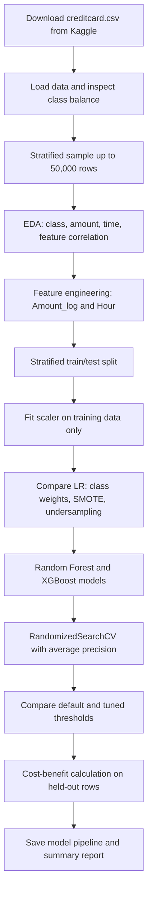

<div align="center">


# Credit Card Fraud Detection
### Imbalanced classification • Precision–recall • Threshold selection • Business cost

<p>
  <a href="https://github.com/DevanshiCodesAI/credit-fraud-detection-supervised-learning/blob/main/FraudDetection_SupervisedLearning.ipynb"></a>
</p>

<p>
  <a href="https://www.kaggle.com/datasets/mlg-ulb/creditcardfraud"></a[...]
  
  
</p>

**A practical machine-learning project for spotting rare fraud transactions without relying on accuracy alone.**

</div>

---

## Contents

- [Project overview](#project-overview)
- [Dataset](#dataset)
- [Project pipeline](#project-pipeline)
- [Why accuracy is misleading](#why-accuracy-is-misleading)
- [Methods and metrics](#methods-and-metrics)
- [Business cost calculation](#business-cost-calculation)
- [Results and graphs](#results-and-graphs)
- [Run the project](#run-the-project)
- [Repository files](#repository-files)
- [Video explanation](#video-explanation)
- [Limitations and next steps](#limitations-and-next-steps)

## Project overview

Credit card fraud is a rare-event problem: most transactions are legitimate, so a model can appear accurate while missing nearly every fraud case. This project builds a simple, end-to-end fraud classi[...]

The notebook works through the project step by step:

1. Load the transaction data and inspect the fraud/legitimate class distribution.
2. Create a stratified sample of up to 50,000 rows for local execution.
3. Explore transaction amount, transaction time and selected PCA features.
4. Create `Amount_log` and `Hour`; standardize those two features only.
5. Compare three imbalance strategies for Logistic Regression.
6. Train and evaluate Random Forest and XGBoost models.
7. Tune XGBoost using average precision, then compare thresholds.
8. Translate model decisions into a simple rupee-based cost-benefit table.
9. Save a prediction pipeline and write a summary report from the notebook results.

> **In plain language:** the model gives each transaction a fraud probability. A threshold turns that probability into an action: review/flag it as fraud, or let it pass as legitimate. The threshold i[...]

## Dataset

The project uses the [Kaggle Credit Card Fraud Detection dataset](https://www.kaggle.com/datasets/mlg-ulb/creditcardfraud). It contains **284,807 transactions**, with **492 fraud cases** (about **0.17[...]

- `Time` is elapsed time in seconds from the first recorded transaction.
- `Amount` is the transaction amount.
- `V1`–`V28` are PCA-transformed input features.
- `Class` is the target label.

The CSV is not included in this repository. Download `creditcard.csv` from Kaggle and put it next to the notebook before running it. The notebook takes a stratified 50,000-row sample if the full datas[...]

## Project pipeline



### Important data-handling choices

- The train/test split is stratified so the rare fraud class is represented in both portions.
- SMOTE and random undersampling are applied to the **training data only**. The test set is left unchanged.
- The `StandardScaler` is fitted on training data only and used for `Amount_log` and `Hour`. The PCA features are already transformed.
- PR-AUC (average precision) is treated as a key ranking metric; accuracy is not used to select the model.

## Why accuracy is misleading

If a classifier predicted every one of the 284,807 transactions as legitimate, it would correctly classify 284,315 transactions. Its accuracy would be:

\[
\text{Accuracy} = \frac{284{,}315}{284{,}807} \approx 99.83\%
\]

But it would catch **0 of the 492 fraud cases**. Its fraud recall would be zero. That is why this project focuses on measures that report how well the model handles the minority class.

<div align="center">
  
  <br><sub>Class counts for the full dataset. Log scale is used so the small fraud bar is visible.</sub>
</div>

## Methods and metrics

### Imbalance strategies

| Strategy | What it does | Benefit | Trade-off |
|---|---|---|---|
| Class weighting | Gives more importance to fraud mistakes while fitting the model | Keeps all original training examples | May need probability-threshold adjustment |
| SMOTE | Creates synthetic fraud examples from training fraud rows | Gives the learner more minority-class examples | Synthetic examples may not represent every real pattern |
| Random undersampling | Removes some legitimate examples from training | Faster and simpler training | Discards information from the majority class |

### Models

- **Logistic Regression:** compared with balanced class weights, SMOTE and random undersampling.
- **Random Forest:** trained with balanced class weights using the best Logistic Regression training strategy from the comparison.
- **XGBoost baseline:** uses `scale_pos_weight` based on the original training class counts.
- **Tuned XGBoost:** searches over tree depth, number of estimators, learning rate, row sampling and feature sampling. `RandomizedSearchCV` uses 3-fold cross-validation and `average_precision` scoring[...]

### Metrics and formulas

Let TP mean fraud correctly flagged, FP mean a legitimate transaction incorrectly flagged, FN mean fraud missed, and TN mean a legitimate transaction correctly passed.

\[
\text{Precision} = \frac{TP}{TP + FP}
\qquad
\text{Recall} = \frac{TP}{TP + FN}
\]

\[
\text{F1} = 2 \times \frac{\text{Precision} \times \text{Recall}}
{\text{Precision} + \text{Recall}}
\]

- **Precision:** among flagged transactions, what fraction were fraud?
- **Recall:** among all actual fraud transactions, what fraction did the model catch?
- **F1-score:** a single summary balancing precision and recall.
- **PR-AUC / average precision:** summarizes precision and recall over score thresholds; particularly helpful when positive cases are rare.

The decision rule is:

```python
fraud_label = int(fraud_probability >= threshold)
```

Reducing the threshold generally flags more transactions. This often increases recall, but can reduce precision by creating more false alarms.

<div align="center">
  
  <br><sub>Conceptual illustration only — actual model curves are plotted by the notebook after it is run.</sub>
</div>

## Business cost calculation

The practical exam provides these simplified assumptions:

- Average value of a fraudulent transaction: **₹4,500**
- Cost to investigate a flagged transaction: **₹150**

The notebook reports the number of caught fraud cases, false alerts and missed fraud cases at several thresholds. Its requested calculations are:

\[
\text{Money saved} = TP \times \text{₹}4{,}500
\]

\[
\text{Investigation cost} = (TP + FP) \times \text{₹}150
\]

\[
\text{Money lost to missed fraud} = FN \times \text{₹}4{,}500
\]

\[
\text{Net benefit (exam definition)} = \text{Money saved} - \text{Investigation cost}
\]

Money lost is shown separately, following the exam's definition of net benefit. The notebook also gives a rough estimate per 50,000 transactions by scaling from the held-out test portion. This is an e[...]

## Results and graphs

Run the notebook to produce the model comparison table, precision-recall curves, Random Forest feature importance plot, threshold comparison and rupee cost table. Metrics depend on the executed model [...]

The static class-count graph above uses the published full-dataset class totals. The precision-recall figure is deliberately labelled as a **schematic**; the notebook's plotted curves are the actual m[...]

## Run the project

### 1. Get the files and dataset

Clone the repository, download `creditcard.csv` from Kaggle, and place the CSV in the project folder:

```bash
git clone https://github.com/DevanshiCodesAI/credit-fraud-detection-supervised-learning.git
cd credit-fraud-detection-supervised-learning
```

### 2. Install the libraries

Use Python 3.10+ if possible. A virtual environment is recommended:

```bash
python -m venv .venv
# Windows: .venv\Scripts\activate
# macOS/Linux: source .venv/bin/activate
pip install -r requirements.txt
```

### 3. Start Jupyter and run all cells

```bash
jupyter notebook FraudDetection_SupervisedLearning.ipynb
```

Run the notebook from top to bottom. XGBoost hyperparameter tuning can take several minutes depending on your computer. At the end, the notebook saves `fraud_detection_model.pkl` and `summary_report.m[...]

### Example: load the saved model

The saved pipeline expects the engineered input columns used in the notebook (V1–V28, `Amount_log`, and `Hour`). Raw `Time` and `Amount` must be transformed in the same way before prediction.

```python
import joblib
import numpy as np

model = joblib.load('fraud_detection_model.pkl')
row = X_test.iloc[[0]]                    # prepared row with engineered features
prob = model.predict_proba(row)[:, 1][0]
label = int(prob >= model.threshold_)
print(f'Fraud probability: {prob:.3f}')
print('Fraud' if label else 'Legitimate')
```

## Repository files

| File | Description |
|---|---|
| `FraudDetection_SupervisedLearning.ipynb` | Main notebook with markdown, code, plots and evaluation steps |
| `Practical Exam _ Set C.pdf` | Practical exam brief containing project questions and theory prompts |
| `fraud_detection_model.pkl` | Serialized prediction pipeline, if generated by a completed notebook run |
| `summary_report.md` | Written project summary; update its placeholders or generate it from a completed run |
| `requirements.txt` | Python package list |
| `images/` | Header/footer GIFs and README graph images |
| `creditcard.csv` | Download separately from Kaggle; not committed to this repository |

## Video explanation

<div id="video-explanation"></div>

**Video link:** _Add your Google Drive share link or unlisted YouTube URL here._

To make the video button above open your recording, replace its `href="#video-explanation"` with your share URL. The practical exam asks for a 5–10 minute recording with your face and screen visible[...]

## Limitations and next steps

1. **Threshold validation:** the practical asks to scan thresholds on `X_test`. For a production estimate, select the threshold on a separate validation set and keep a final test set untouched for one[...]
2. **Business assumptions:** actual fraud amounts, chargebacks, investigation costs and customer friction will vary. Replace the exam assumptions with measured business costs.
3. **Monitoring:** track fraud rate, recall, PR-AUC, false-alert volume, customer complaints and data drift as transactions change over time.
4. **Feedback:** capture investigator decisions and confirmed fraud outcomes for monitoring and careful retraining.
5. **Operations:** test real-time scoring latency, access controls, failure handling and a safe fallback before launch.

This is an educational project and should not be used to automatically block real payments without further validation and human/business review.

---

<div align="center">
  
  <br>
  <sub>Made for learning about rare-event classification and practical model evaluation.</sub>
</div>
